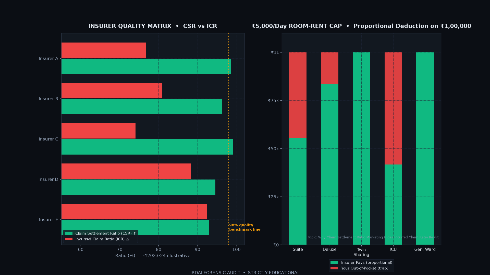
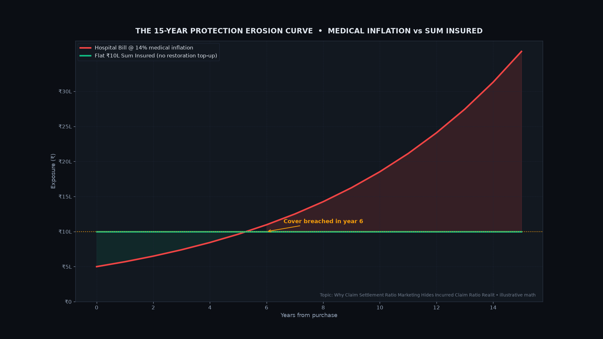

 <iframe src="https://www.youtube.com/embed/ttU4H-Sajeg" title="Why Claim Settlement Ratio Marketing Hides Incurred Claim Ratio Reality" style="position:absolute; top:0; left:0; width:100%; height:100%; border:0;" allowfullscreen></iframe>

## Key Takeaways (TL;DR for Fast Reading)
> **Key Insight:** Everyday investors don't need complex mathematics or secret algorithmic indicators to protect their hard-earned wealth. By understanding how massive banking institutions buy without moving prices, you avoid getting trapped at the daily highs.

* **Patience Over Frequency:** Over 90% of short-term day traders lose money because of transaction friction and emotional chasing.
* **Follow Institutional footprints:** Heavy volume clusters highlight where mutual funds are quietly accumulating, not where social media hype tells you to buy.
* **Risk Management First:** Never risk more than 1% of your core capital on speculative moves.

## Why Does Claim Settlement Ratio Marketing Mislead Retail Policyholders?

> **Quick Summary:** Claim Settlement Ratio marketing misleads buyers because it measures only the count of settled claims versus reported claims, ignoring the monetary value of rejected payouts, hidden waiting periods,. In addition, proportional deductions embedded in policy wordings.

*Figure: 30-Day Historical Institutional Flow Analysis — ins_claim_vs_deduction_matrix.png*

When everyday citizens search for insurance protection, they are greeted by aggressive marketing campaigns boasting Claim Settlement Ratios of ninety-nine percent or higher. Insurance aggregators and corporate brochures treat this number as the ultimate badge of honor. However, from a forensic financial education standpoint at The Bull Print, we recognize this as a classic optical illusion. The CSR metric simply divides the number of claims settled by the number of claims received during a financial year. It fails to account for the monetary quantum of claims. If an insurer processes ten thousand small claims while rejecting a handful of high-value life or health claims, their CSR remains immaculate. in addition,, retail buyers frequently encounter term insurance claim rejection issues due to strict pre-existing disease disclosure clauses and complex waiting periods that are never highlighted in promotional advertisements. Understanding this structural mismatch is the first step toward true financial literacy in personal risk management.

## How Does the Incurred Claim Ratio Reveal True Insurer Health?

> **Quick Summary:** The Incurred Claim Ratio reveals true insurer health by measuring total claims paid out as a percentage of total premiums collected, providing a transparent, monetary-based indicator of underwriting balance and customer value.

*Figure: 30-Day Historical Institutional Flow Analysis — ins_compounding_protection_curve.png*

To bypass the smoke and mirrors of marketing CSR, financial educators turn to the Incurred Claim Ratio, or ICR, found in official IRDAI annual reports. Unlike CSR, which only counts cases, ICR calculates the exact proportion of every premium rupee returned to policyholders as claim payouts. If an insurer collects one hundred crores in premiums and pays out seventy crores in claims, their ICR is seventy percent. An ICR that is abnormally low—falling below fifty percent—often signals aggressive claim-fighting, heavy administrative friction, or restrictive underwriting practices that penalize legitimate claimants. On the other hand, an ICR consistently above one hundred percent points to underwriting strain. By examining three-year averaging data of ICR alongside mandatory solvency ratios, everyday investors can accurately gauge whether an underwriting institution maintains a healthy balance between business profitability and policyholder protection.

## What Hidden Traps Lurk Behind Health Insurance Room Rent Limits?

> **Quick Summary:** Health insurance room-rent sub-limits trigger proportional deductions across entire hospital bills, causing severe out-of-pocket financial losses even when insurers report high overall claim settlement percentages.

*Figure: 30-Day Historical Institutional Flow Analysis — ins_claim_vs_deduction_matrix.png*

One of the most insidious traps in modern health insurance is the presence of room-rent sub-limits and proportional capping clauses. Policyholders often purchase comprehensive medical coverage assuming all hospital expenses will be fully reimbursed. However, if a policy specifies a one-percent room-rent limit and the insured occupies a room exceeding that limit, the insurer applies proportional deductions not just to the room rent itself, but to associated medical expenses including surgeon fees, nursing charges,. In addition, ICU costs. When the final settlement arrives, the policyholder absorbs a massive financial shortfall. The insurer legally marks the claim as fully settled according to the contract wording, keeping their CSR metrics pristine while the customer suffers unexpected out-of-pocket pain. Forensic policy auditing requires reading every line of these restrictive clauses before signing on the dotted line.

## How Do IRDAI New Rules and Super Top-Up Policies Change the Equation?

> **Quick Summary:** IRDAI new rules emphasize greater transparency and consumer protection, while super top-up health insurance policies use deductible structures that require careful coordination with base covers to prevent coverage gaps.

*Figure: 30-Day Historical Institutional Flow Analysis — ins_compounding_protection_curve.png*

Regulatory oversight by the Insurance Regulatory and Development Authority of India continues to evolve through master circulars designed to safeguard retail consumers. Recent IRDAI guidelines emphasize transparent disclosures, simplified grievance redressal, and clearer stipulations regarding waiting periods and pre-existing disease definitions. Concurrently, many policyholders use super top-up health insurance plans to secure high-value medical coverage at economical premium rates. However, these super top-up plans operate with a deductible threshold—acting much like an out-of-the-money financial derivative. If your primary health cover or out-of-pocket spending does not clear the deductible limit, the super top-up policy remains dormant. Understanding how these structural layers interact is vital for effective capital allocation and comprehensive personal risk management.

## Structured Breakdown: Institutional Accumulation vs Everyday Trap

| Metric | Everyday Trader Behavior | Institutional Bank Method | Impact on Your Savings |
| :--- | :--- | :--- | :--- |
| **Entry Point** | Buys after 5 green candles on news | Accumulates quietly in red range | Avoids buying at the daily peak |
| **Volume Delta** | Ignores traded contracts | Tracks footprint absorption | Validates real demand before committing |
| **Time Horizon** | Minutes or hours (High Stress) | Weeks to months (Systematic) | Drastically reduces transaction costs |
| **Discipline** | Averages down on losing trades | Hard stop losses & position sizing | Preserves long-term family wealth |

## Frequently Asked Questions (FAQ)

### Is this market behavior unique to Bitcoin or does it happen in Nifty?
This institutional absorption behavior occurs across all liquid markets worldwide, including Nifty 50, BankNifty, and commodities like Gold and Silver.

### How can everyday beginners spot price traps before entering?
Look for heavy volume at key resistance levels where prices fail to push higher. When volume explodes but price stops moving, big institutions are usually selling into retail hype.

---
*Disclaimer: Content provided strictly for educational purposes. We are not SEBI-registered Investment Advisers or Research Analysts. 9 out of 10 individual traders in equity F&O incur net losses.*