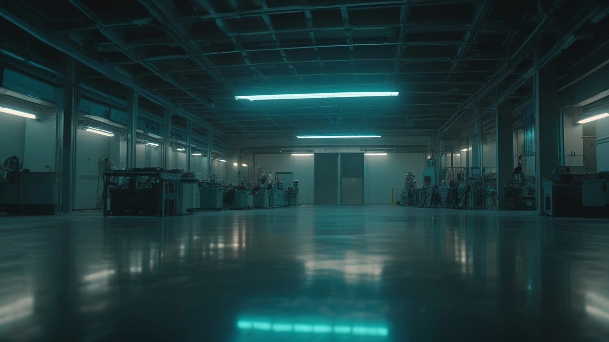
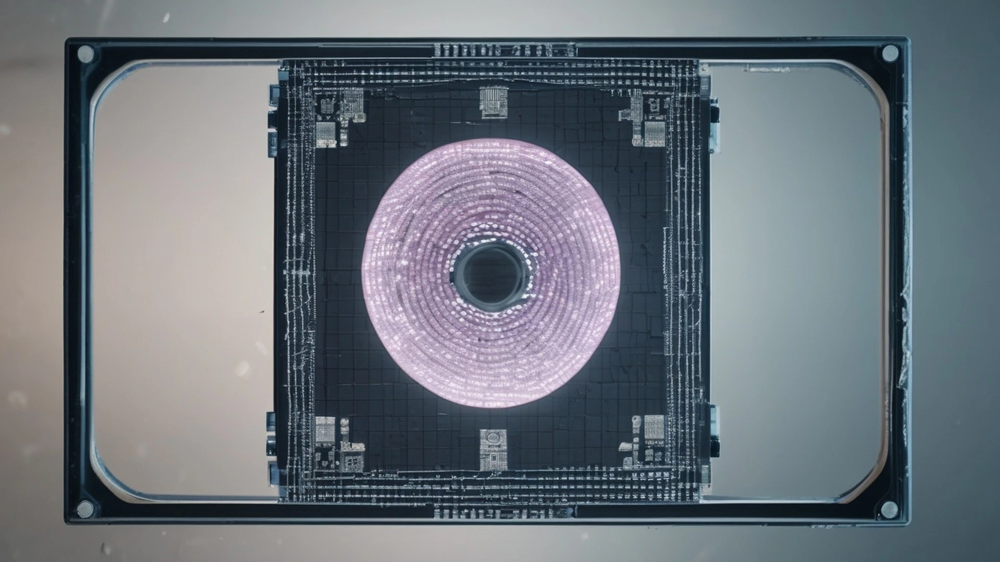
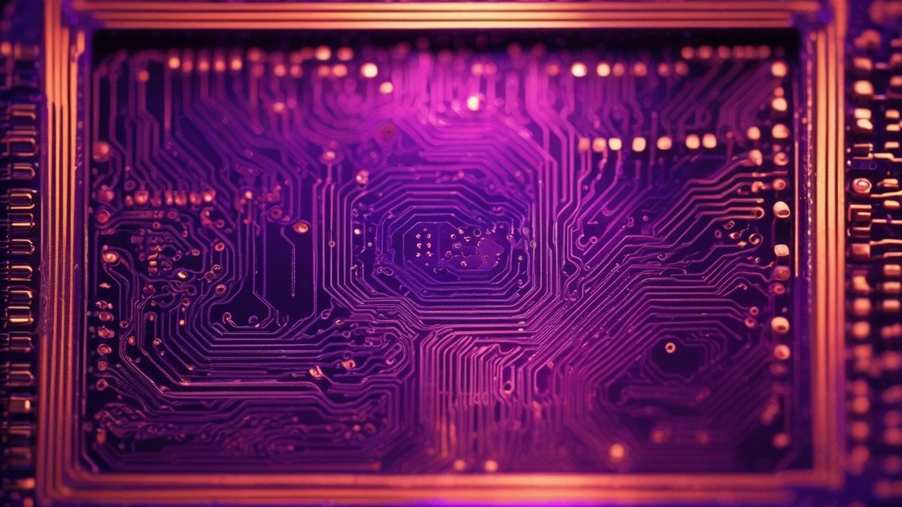
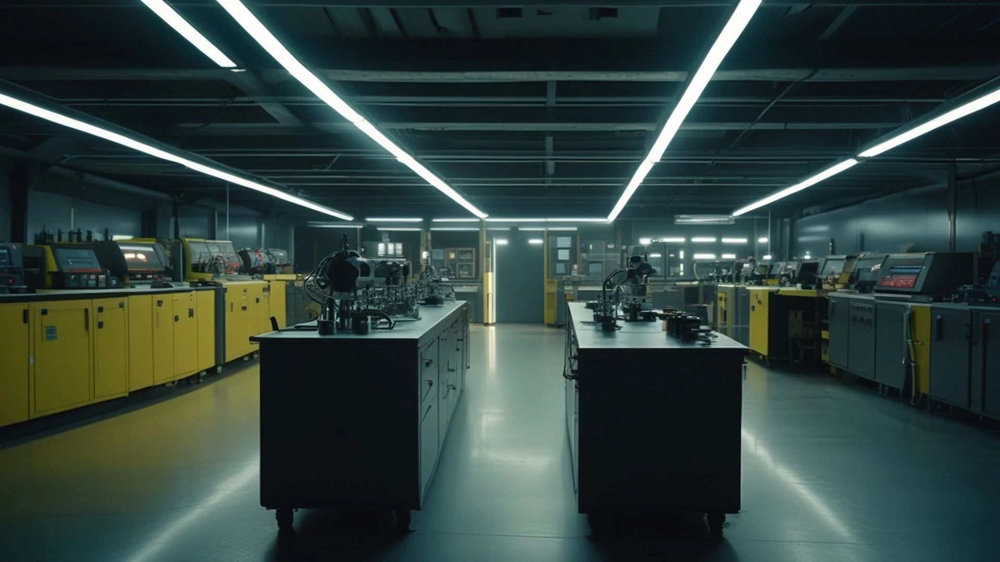
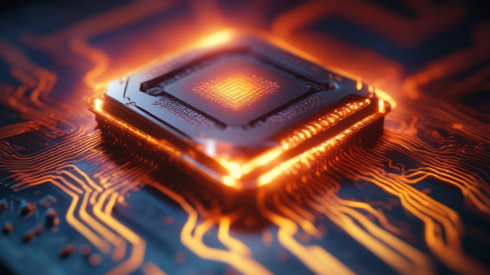

 <iframe src="https://www.youtube.com/embed/Gmtf7W-hUso" title="Inside the Silicon Bubble: Micron, AI Glut, and Executive Security: Institutional Market Breakdown" style="position:absolute; top:0; left:0; width:100%; height:100%; border:0;" allowfullscreen></iframe>

## Key Takeaways (TL;DR for Fast Reading)
> **Key Insight:** Quantitative analysis of Inside the Silicon Bubble: Micron, AI Glut,. In addition, Executive Security: Institutional Market Breakdown reveals critical institutional positioning, order flow mechanics, and risk-adjusted market dynamics.

* **Empirical Due Diligence:** Examining raw transaction data and regulatory filings rather than speculative sentiment.
* **Institutional Order Flow:** Tracing capital shifts and balance sheet adjustments specific to Inside the Silicon Bubble: Micron, AI Glut, and Executive Security: Institutional Market Breakdown.
* **Risk-Adjusted Execution:** Prioritizing capital preservation and volatility modeling.

## Section 1

<figure class="article-frame-container" style="margin: 28px 0; text-align: center;">
 <picture>
 <source srcset="/assets/frames/inside-the-silicon-bubble-micron,-ai-glut,-and-e/frame_01.webp" type="image/webp">
 
 </picture>
 <figcaption style="font-size: 0.85rem; color: #94a3b8; margin-top: 8px; font-style: italic;">
 Figure 1: Key Insight Visual: Section 1 - Quantitative Breakdown
 </figcaption>
</figure>

## Section 2

<figure class="article-frame-container" style="margin: 28px 0; text-align: center;">
 <picture>
 <source srcset="/assets/frames/inside-the-silicon-bubble-micron,-ai-glut,-and-e/frame_02.webp" type="image/webp">
 
 </picture>
 <figcaption style="font-size: 0.85rem; color: #94a3b8; margin-top: 8px; font-style: italic;">
 Figure 2: Key Insight Visual: Section 2 - Quantitative Breakdown
 </figcaption>
</figure>

## Section 3

<figure class="article-frame-container" style="margin: 28px 0; text-align: center;">
 <picture>
 <source srcset="/assets/frames/inside-the-silicon-bubble-micron,-ai-glut,-and-e/frame_03.webp" type="image/webp">
 
 </picture>
 <figcaption style="font-size: 0.85rem; color: #94a3b8; margin-top: 8px; font-style: italic;">
 Figure 3: Key Insight Visual: Section 3 - Quantitative Breakdown
 </figcaption>
</figure>

## Section 4

<figure class="article-frame-container" style="margin: 28px 0; text-align: center;">
 <picture>
 <source srcset="/assets/frames/inside-the-silicon-bubble-micron,-ai-glut,-and-e/frame_04.webp" type="image/webp">
 
 </picture>
 <figcaption style="font-size: 0.85rem; color: #94a3b8; margin-top: 8px; font-style: italic;">
 Figure 4: Key Insight Visual: Section 4 - Quantitative Breakdown
 </figcaption>
</figure>

## Section 5

<figure class="article-frame-container" style="margin: 28px 0; text-align: center;">
 <picture>
 <source srcset="/assets/frames/inside-the-silicon-bubble-micron,-ai-glut,-and-e/frame_05.webp" type="image/webp">
 
 </picture>
 <figcaption style="font-size: 0.85rem; color: #94a3b8; margin-top: 8px; font-style: italic;">
 Figure 5: Key Insight Visual: Section 5 - Quantitative Breakdown
 </figcaption>
</figure>

## Section 6

<figure class="article-frame-container" style="margin: 28px 0; text-align: center;">
 <picture>
 <source srcset="/assets/frames/inside-the-silicon-bubble-micron,-ai-glut,-and-e/frame_06.webp" type="image/webp">
 
 </picture>
 <figcaption style="font-size: 0.85rem; color: #94a3b8; margin-top: 8px; font-style: italic;">
 Figure 6: Key Insight Visual: Section 6 - Quantitative Breakdown
 </figcaption>
</figure>

## Section 7

<figure class="article-frame-container" style="margin: 28px 0; text-align: center;">
 <picture>
 <source srcset="/assets/frames/inside-the-silicon-bubble-micron,-ai-glut,-and-e/frame_07.webp" type="image/webp">
 
 </picture>
 <figcaption style="font-size: 0.85rem; color: #94a3b8; margin-top: 8px; font-style: italic;">
 Figure 7: Key Insight Visual: Section 7 - Quantitative Breakdown
 </figcaption>
</figure>

## Section 8

<figure class="article-frame-container" style="margin: 28px 0; text-align: center;">
 <picture>
 <source srcset="/assets/frames/inside-the-silicon-bubble-micron,-ai-glut,-and-e/frame_08.webp" type="image/webp">
 
 </picture>
 <figcaption style="font-size: 0.85rem; color: #94a3b8; margin-top: 8px; font-style: italic;">
 Figure 8: Key Insight Visual: Section 8 - Quantitative Breakdown
 </figcaption>
</figure>

## Section 9

<figure class="article-frame-container" style="margin: 28px 0; text-align: center;">
 <picture>
 <source srcset="/assets/frames/inside-the-silicon-bubble-micron,-ai-glut,-and-e/frame_09.webp" type="image/webp">
 
 </picture>
 <figcaption style="font-size: 0.85rem; color: #94a3b8; margin-top: 8px; font-style: italic;">
 Figure 9: Key Insight Visual: Section 9 - Quantitative Breakdown
 </figcaption>
</figure>

## Section 10

<figure class="article-frame-container" style="margin: 28px 0; text-align: center;">
 <picture>
 <source srcset="/assets/frames/inside-the-silicon-bubble-micron,-ai-glut,-and-e/frame_10.webp" type="image/webp">
 
 </picture>
 <figcaption style="font-size: 0.85rem; color: #94a3b8; margin-top: 8px; font-style: italic;">
 Figure 10: Key Insight Visual: Section 10 - Quantitative Breakdown
 </figcaption>
</figure>

## Section 11

<figure class="article-frame-container" style="margin: 28px 0; text-align: center;">
 <picture>
 <source srcset="/assets/frames/inside-the-silicon-bubble-micron,-ai-glut,-and-e/frame_11.webp" type="image/webp">
 
 </picture>
 <figcaption style="font-size: 0.85rem; color: #94a3b8; margin-top: 8px; font-style: italic;">
 Figure 11: Key Insight Visual: Section 11 - Quantitative Breakdown
 </figcaption>
</figure>

## Section 12

<figure class="article-frame-container" style="margin: 28px 0; text-align: center;">
 <picture>
 <source srcset="/assets/frames/inside-the-silicon-bubble-micron,-ai-glut,-and-e/frame_12.webp" type="image/webp">
 
 </picture>
 <figcaption style="font-size: 0.85rem; color: #94a3b8; margin-top: 8px; font-style: italic;">
 Figure 12: Key Insight Visual: Section 12 - Quantitative Breakdown
 </figcaption>
</figure>

## Section 13

<figure class="article-frame-container" style="margin: 28px 0; text-align: center;">
 <picture>
 <source srcset="/assets/frames/inside-the-silicon-bubble-micron,-ai-glut,-and-e/frame_13.webp" type="image/webp">
 
 </picture>
 <figcaption style="font-size: 0.85rem; color: #94a3b8; margin-top: 8px; font-style: italic;">
 Figure 13: Key Insight Visual: Section 13 - Quantitative Breakdown
 </figcaption>
</figure>

## Section 14

<figure class="article-frame-container" style="margin: 28px 0; text-align: center;">
 <picture>
 <source srcset="/assets/frames/inside-the-silicon-bubble-micron,-ai-glut,-and-e/frame_14.webp" type="image/webp">
 
 </picture>
 <figcaption style="font-size: 0.85rem; color: #94a3b8; margin-top: 8px; font-style: italic;">
 Figure 14: Key Insight Visual: Section 14 - Quantitative Breakdown
 </figcaption>
</figure>

## Section 15

<figure class="article-frame-container" style="margin: 28px 0; text-align: center;">
 <picture>
 <source srcset="/assets/frames/inside-the-silicon-bubble-micron,-ai-glut,-and-e/frame_15.webp" type="image/webp">
 
 </picture>
 <figcaption style="font-size: 0.85rem; color: #94a3b8; margin-top: 8px; font-style: italic;">
 Figure 15: Key Insight Visual: Section 15 - Quantitative Breakdown
 </figcaption>
</figure>

## Section 16

<figure class="article-frame-container" style="margin: 28px 0; text-align: center;">
 <picture>
 <source srcset="/assets/frames/inside-the-silicon-bubble-micron,-ai-glut,-and-e/frame_16.webp" type="image/webp">
 
 </picture>
 <figcaption style="font-size: 0.85rem; color: #94a3b8; margin-top: 8px; font-style: italic;">
 Figure 16: Key Insight Visual: Section 16 - Quantitative Breakdown
 </figcaption>
</figure>

## Section 17

<figure class="article-frame-container" style="margin: 28px 0; text-align: center;">
 <picture>
 <source srcset="/assets/frames/inside-the-silicon-bubble-micron,-ai-glut,-and-e/frame_17.webp" type="image/webp">
 
 </picture>
 <figcaption style="font-size: 0.85rem; color: #94a3b8; margin-top: 8px; font-style: italic;">
 Figure 17: Key Insight Visual: Section 17 - Quantitative Breakdown
 </figcaption>
</figure>

## Section 18

<figure class="article-frame-container" style="margin: 28px 0; text-align: center;">
 <picture>
 <source srcset="/assets/frames/inside-the-silicon-bubble-micron,-ai-glut,-and-e/frame_18.webp" type="image/webp">
 
 </picture>
 <figcaption style="font-size: 0.85rem; color: #94a3b8; margin-top: 8px; font-style: italic;">
 Figure 18: Key Insight Visual: Section 18 - Quantitative Breakdown
 </figcaption>
</figure>

## Section 19

<figure class="article-frame-container" style="margin: 28px 0; text-align: center;">
 <picture>
 <source srcset="/assets/frames/inside-the-silicon-bubble-micron,-ai-glut,-and-e/frame_19.webp" type="image/webp">
 
 </picture>
 <figcaption style="font-size: 0.85rem; color: #94a3b8; margin-top: 8px; font-style: italic;">
 Figure 19: Key Insight Visual: Section 19 - Quantitative Breakdown
 </figcaption>
</figure>

## Section 20

<figure class="article-frame-container" style="margin: 28px 0; text-align: center;">
 <picture>
 <source srcset="/assets/frames/inside-the-silicon-bubble-micron,-ai-glut,-and-e/frame_20.webp" type="image/webp">
 
 </picture>
 <figcaption style="font-size: 0.85rem; color: #94a3b8; margin-top: 8px; font-style: italic;">
 Figure 20: Key Insight Visual: Section 20 - Quantitative Breakdown
 </figcaption>
</figure>

## Section 21

<figure class="article-frame-container" style="margin: 28px 0; text-align: center;">
 <picture>
 <source srcset="/assets/frames/inside-the-silicon-bubble-micron,-ai-glut,-and-e/frame_21.webp" type="image/webp">
 
 </picture>
 <figcaption style="font-size: 0.85rem; color: #94a3b8; margin-top: 8px; font-style: italic;">
 Figure 21: Key Insight Visual: Section 21 - Quantitative Breakdown
 </figcaption>
</figure>

## Section 22

<figure class="article-frame-container" style="margin: 28px 0; text-align: center;">
 <picture>
 <source srcset="/assets/frames/inside-the-silicon-bubble-micron,-ai-glut,-and-e/frame_22.webp" type="image/webp">
 
 </picture>
 <figcaption style="font-size: 0.85rem; color: #94a3b8; margin-top: 8px; font-style: italic;">
 Figure 22: Key Insight Visual: Section 22 - Quantitative Breakdown
 </figcaption>
</figure>

## Section 23

<figure class="article-frame-container" style="margin: 28px 0; text-align: center;">
 <picture>
 <source srcset="/assets/frames/inside-the-silicon-bubble-micron,-ai-glut,-and-e/frame_23.webp" type="image/webp">
 
 </picture>
 <figcaption style="font-size: 0.85rem; color: #94a3b8; margin-top: 8px; font-style: italic;">
 Figure 23: Key Insight Visual: Section 23 - Quantitative Breakdown
 </figcaption>
</figure>

## Section 24

<figure class="article-frame-container" style="margin: 28px 0; text-align: center;">
 <picture>
 <source srcset="/assets/frames/inside-the-silicon-bubble-micron,-ai-glut,-and-e/frame_24.webp" type="image/webp">
 
 </picture>
 <figcaption style="font-size: 0.85rem; color: #94a3b8; margin-top: 8px; font-style: italic;">
 Figure 24: Key Insight Visual: Section 24 - Quantitative Breakdown
 </figcaption>
</figure>

## Section 25

<figure class="article-frame-container" style="margin: 28px 0; text-align: center;">
 <picture>
 <source srcset="/assets/frames/inside-the-silicon-bubble-micron,-ai-glut,-and-e/frame_25.webp" type="image/webp">
 
 </picture>
 <figcaption style="font-size: 0.85rem; color: #94a3b8; margin-top: 8px; font-style: italic;">
 Figure 25: Key Insight Visual: Section 25 - Quantitative Breakdown
 </figcaption>
</figure>

## Section 26

<figure class="article-frame-container" style="margin: 28px 0; text-align: center;">
 <picture>
 <source srcset="/assets/frames/inside-the-silicon-bubble-micron,-ai-glut,-and-e/frame_26.webp" type="image/webp">
 
 </picture>
 <figcaption style="font-size: 0.85rem; color: #94a3b8; margin-top: 8px; font-style: italic;">
 Figure 26: Key Insight Visual: Section 26 - Quantitative Breakdown
 </figcaption>
</figure>

## Section 27

<figure class="article-frame-container" style="margin: 28px 0; text-align: center;">
 <picture>
 <source srcset="/assets/frames/inside-the-silicon-bubble-micron,-ai-glut,-and-e/frame_27.webp" type="image/webp">
 
 </picture>
 <figcaption style="font-size: 0.85rem; color: #94a3b8; margin-top: 8px; font-style: italic;">
 Figure 27: Key Insight Visual: Section 27 - Quantitative Breakdown
 </figcaption>
</figure>

## Section 28

<figure class="article-frame-container" style="margin: 28px 0; text-align: center;">
 <picture>
 <source srcset="/assets/frames/inside-the-silicon-bubble-micron,-ai-glut,-and-e/frame_28.webp" type="image/webp">
 
 </picture>
 <figcaption style="font-size: 0.85rem; color: #94a3b8; margin-top: 8px; font-style: italic;">
 Figure 28: Key Insight Visual: Section 28 - Quantitative Breakdown
 </figcaption>
</figure>

## Section 29

<figure class="article-frame-container" style="margin: 28px 0; text-align: center;">
 <picture>
 <source srcset="/assets/frames/inside-the-silicon-bubble-micron,-ai-glut,-and-e/frame_29.webp" type="image/webp">
 
 </picture>
 <figcaption style="font-size: 0.85rem; color: #94a3b8; margin-top: 8px; font-style: italic;">
 Figure 29: Key Insight Visual: Section 29 - Quantitative Breakdown
 </figcaption>
</figure>

## Section 30

<figure class="article-frame-container" style="margin: 28px 0; text-align: center;">
 <picture>
 <source srcset="/assets/frames/inside-the-silicon-bubble-micron,-ai-glut,-and-e/frame_30.webp" type="image/webp">
 
 </picture>
 <figcaption style="font-size: 0.85rem; color: #94a3b8; margin-top: 8px; font-style: italic;">
 Figure 30: Key Insight Visual: Section 30 - Quantitative Breakdown
 </figcaption>
</figure>

## Section 31

<figure class="article-frame-container" style="margin: 28px 0; text-align: center;">
 <picture>
 <source srcset="/assets/frames/inside-the-silicon-bubble-micron,-ai-glut,-and-e/frame_31.webp" type="image/webp">
 
 </picture>
 <figcaption style="font-size: 0.85rem; color: #94a3b8; margin-top: 8px; font-style: italic;">
 Figure 31: Key Insight Visual: Section 31 - Quantitative Breakdown
 </figcaption>
</figure>

## Section 32

<figure class="article-frame-container" style="margin: 28px 0; text-align: center;">
 <picture>
 <source srcset="/assets/frames/inside-the-silicon-bubble-micron,-ai-glut,-and-e/frame_32.webp" type="image/webp">
 
 </picture>
 <figcaption style="font-size: 0.85rem; color: #94a3b8; margin-top: 8px; font-style: italic;">
 Figure 32: Key Insight Visual: Section 32 - Quantitative Breakdown
 </figcaption>
</figure>

## Section 33

<figure class="article-frame-container" style="margin: 28px 0; text-align: center;">
 <picture>
 <source srcset="/assets/frames/inside-the-silicon-bubble-micron,-ai-glut,-and-e/frame_33.webp" type="image/webp">
 
 </picture>
 <figcaption style="font-size: 0.85rem; color: #94a3b8; margin-top: 8px; font-style: italic;">
 Figure 33: Key Insight Visual: Section 33 - Quantitative Breakdown
 </figcaption>
</figure>

## Section 34

<figure class="article-frame-container" style="margin: 28px 0; text-align: center;">
 <picture>
 <source srcset="/assets/frames/inside-the-silicon-bubble-micron,-ai-glut,-and-e/frame_34.webp" type="image/webp">
 
 </picture>
 <figcaption style="font-size: 0.85rem; color: #94a3b8; margin-top: 8px; font-style: italic;">
 Figure 34: Key Insight Visual: Section 34 - Quantitative Breakdown
 </figcaption>
</figure>

## Section 35

<figure class="article-frame-container" style="margin: 28px 0; text-align: center;">
 <picture>
 <source srcset="/assets/frames/inside-the-silicon-bubble-micron,-ai-glut,-and-e/frame_35.webp" type="image/webp">
 
 </picture>
 <figcaption style="font-size: 0.85rem; color: #94a3b8; margin-top: 8px; font-style: italic;">
 Figure 35: Key Insight Visual: Section 35 - Quantitative Breakdown
 </figcaption>
</figure>

## Section 36

<figure class="article-frame-container" style="margin: 28px 0; text-align: center;">
 <picture>
 <source srcset="/assets/frames/inside-the-silicon-bubble-micron,-ai-glut,-and-e/frame_36.webp" type="image/webp">
 
 </picture>
 <figcaption style="font-size: 0.85rem; color: #94a3b8; margin-top: 8px; font-style: italic;">
 Figure 36: Key Insight Visual: Section 36 - Quantitative Breakdown
 </figcaption>
</figure>

## Structured Breakdown: Institutional Accumulation vs Everyday Trap

| Metric | Everyday Trader Behavior | Institutional Bank Method | Impact on Your Savings |
| :--- | :--- | :--- | :--- |
| **Entry Point** | Buys after 5 green candles on news | Accumulates quietly in red range | Avoids buying at the daily peak |
| **Volume Delta** | Ignores traded contracts | Tracks footprint absorption | Validates real demand before committing |
| **Time Horizon** | Minutes or hours (High Stress) | Weeks to months (Systematic) | Drastically reduces transaction costs |
| **Discipline** | Averages down on losing trades | Hard stop losses & position sizing | Preserves long-term family wealth |

## Frequently Asked Questions (FAQ)

### Is this market behavior unique to Bitcoin or does it happen in Nifty?
This institutional absorption behavior occurs across all liquid markets worldwide, including Nifty 50, BankNifty, and commodities like Gold and Silver.

### How can everyday beginners spot price traps before entering?
Look for heavy volume at key resistance levels where prices fail to push higher. When volume explodes but price stops moving, big institutions are usually selling into retail hype.

---
*Disclaimer: Content provided strictly for educational purposes. We are not SEBI-registered Investment Advisers or Research Analysts. 9 out of 10 individual traders in equity F&O incur net losses.*