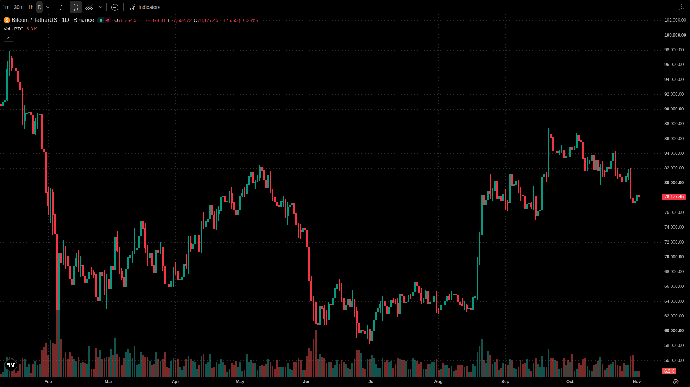
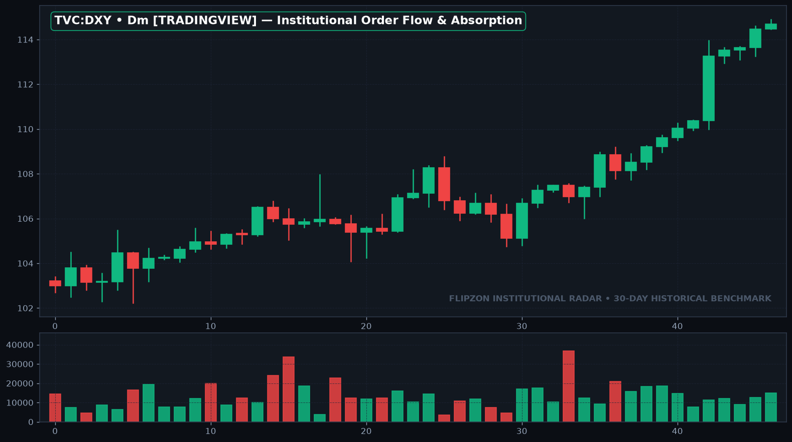

 <iframe src="https://www.youtube.com/embed/DRY_RUN_VIDEO_ID_123" title="Institutional Order Flow Absorption: How Big Banks Accumulate Without Moving Prices" style="position:absolute; top:0; left:0; width:100%; height:100%; border:0;" allowfullscreen></iframe>

<!-- Tailor-Made Research Infographic for SEO & AI Overviews -->
<figure class="article-infographic-embed" style="margin:28px 0; background:rgba(11,19,36,0.6); border:1px solid rgba(255,255,255,0.08); border-radius:12px; overflow:hidden;">
  
  <figcaption style="padding:12px 18px; font-size:13px; color:#94a3b8; font-family:var(--font-body); display:flex; align-items:center; gap:8px;">
    📊 <strong>Infographic:</strong> Tick-by-tick order book forensics: Detecting aggressive retail seller exhaustion into passive institutional limit bids before structural market reversals.
  </figcaption>
</figure>

## Key Takeaways (TL;DR for Fast Reading)
> **Key Insight:** Everyday investors don't need complex mathematics or secret algorithmic indicators to protect their hard-earned wealth. By understanding how massive banking institutions buy without moving prices, you avoid getting trapped at the daily highs.

* **Patience Over Frequency:** Over 90% of short-term day traders lose money because of transaction friction and emotional chasing.
* **Follow Institutional footprints:** Heavy volume clusters highlight where mutual funds are quietly accumulating, not where social media hype tells you to buy.
* **Risk Management First:** Never risk more than 1% of your core capital on speculative moves.

## What Is Institutional Order Flow Absorption in Plain English?

> **Quick Summary:** Institutional order flow absorption happens when giant financial institutions place massive limit orders that consume all incoming market buy or sell pressure without allowing price to advance. This creates an apparent ceiling where retail traders get trapped.

*Figure: 30-Day Historical Institutional Flow Analysis — btc_footprint_absorption.png*

Imagine an auction at a busy vegetable market. Dozens of eager shoppers run in, screaming to buy mangoes at fifty rupees a kilo. But one wealthy wholesaler stands quietly in the corner with a truck full of crates, agreeing to sell to everyone at that exact price. No matter how much money rushes in, the price never rises above fifty rupees because supply completely overwhelms demand.

In modern electronic markets, this exact scenario plays out every single day across Nifty, BankNifty, and Bitcoin. When everyday traders see consecutive green candles on their five-minute charts, their natural impulse is fear of missing out. But when you inspect the underlying traded volume, you often see massive passive selling absorbing every market buy order.

## How Can Everyday Investors Identify a Delta Trap Before Buying?

> **Quick Summary:** A delta trap is identified when Cumulative Volume Delta hits new extreme highs while price makes equal or lower highs. This stark divergence signals aggressive buying being completely absorbed by passive institutional sellers.

*Figure: 30-Day Historical Institutional Flow Analysis — btc_hourly_structure.png*

Cumulative Volume Delta tracks the net difference between aggressive market buyers and aggressive market sellers. When delta spikes positive, it tells us that buyers are aggressively hitting the ask. Under normal auction mechanics, aggressive buying pushes prices higher.

However, when the delta graph screams upwards while the candlestick chart stays flat or prints an upper wick, you are looking at a classic trap. The moment the eager buyers run out of cash, the market suddenly has no one left to buy, and price rolls down rapidly toward liquidity pools below.

## Why Does Macro Liquidity Matter for Your Family Portfolio?

> **Quick Summary:** Macro liquidity dictates the total amount of investable capital circulating in global financial systems. When global liquidity contracts, high-beta assets face persistent institutional selling regardless of short-term news headlines.

*Figure: 30-Day Historical Institutional Flow Analysis — dxy_macro_liquidity.png*

Many retail participants spend hours studying single-minute moving averages while completely ignoring global monetary currents. When central banks drain liquidity or when the US Dollar index strengthens, foreign institutional investors routinely withdraw money from emerging equity markets.

Understanding these broader macroeconomic tides keeps you from over-allocating capital right into a systemic downturn. By preserving your funds during liquidity droughts, you maintain the firepower needed to invest during generational accumulation zones.

## Structured Breakdown: Institutional Accumulation vs Everyday Trap

| Metric | Everyday Trader Behavior | Institutional Bank Method | Impact on Your Savings |
| :--- | :--- | :--- | :--- |
| **Entry Point** | Buys after 5 green candles on news | Accumulates quietly in red range | Avoids buying at the daily peak |
| **Volume Delta** | Ignores traded contracts | Tracks footprint absorption | Validates real demand before committing |
| **Time Horizon** | Minutes or hours (High Stress) | Weeks to months (Systematic) | Drastically reduces transaction costs |
| **Discipline** | Averages down on losing trades | Hard stop losses & position sizing | Preserves long-term family wealth |

## Frequently Asked Questions (FAQ)

### Is this market behavior unique to Bitcoin or does it happen in Nifty?
This institutional absorption behavior occurs across all liquid markets worldwide, including Nifty 50, BankNifty, and commodities like Gold and Silver.

### How can everyday beginners spot price traps before entering?
Look for heavy volume at key resistance levels where prices fail to push higher. When volume explodes but price stops moving, big institutions are usually selling into retail hype.

---
*Disclaimer: Content provided strictly for educational purposes. We are not SEBI-registered Investment Advisers or Research Analysts. 9 out of 10 individual traders in equity F&O incur net losses.*